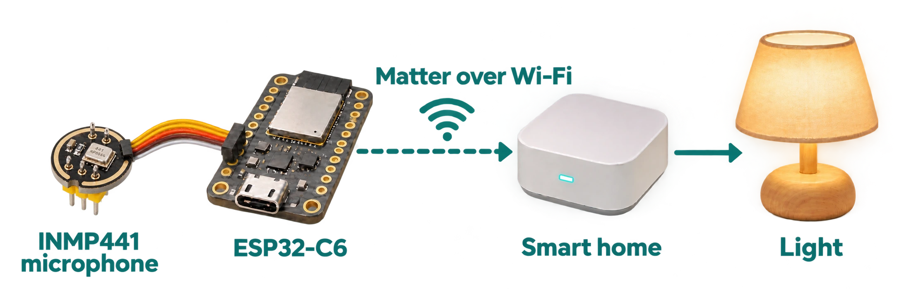

# Clap-Clap



Clap twice to toggle a light or start an automation in your smart home that supports Matter.

The ESP32 uses a small neural network to recognize claps. Start with the included example model. If it misses claps or triggers on other sounds, you can train a model on your computer using sounds from your room. During normal use, audio stays on the board. No cloud needed.

## Quick start

[Set up with a coding agent](#setup-with-a-coding-agent) or follow the [manual steps](#hardware-and-wiring).

### 1. Connect the microphone

You'll need an ESP32-C6, an INMP441 mic module, a few wires, and a USB data cable. Tell the agent what you already have. It can help you find the missing parts and connect the mic one wire at a time.

### 2. Flash the firmware with the example model

[Build and flash the firmware](#flash-the-firmware) with the included model. Open the USB serial monitor and send `?`. Look for `Clap detector: enabled`.

### 3. Pair the button and try it

[Read the Matter pairing code](#read-the-matter-pairing-code) from the ESP32 over USB or ask the agent to read it. Enter the code in your smart home app, set a button press to toggle a light, then clap twice to try it. [Home Assistant example](#home-assistant-automation)

Once the automation works, unplug Clap-Clap from your computer and power it from a USB-C charger or another USB-C port that supplies power. Put it somewhere convenient where the microphone can pick up your claps and the board can stay connected to Wi-Fi.

[Troubleshoot the setup](#troubleshooting) if the light doesn't toggle. If the BOOT button works but the detector misses claps or triggers on other sounds, [train a model for your room](#train-a-model-for-your-room).

## Setup with a coding agent

Paste the prompt below into a coding agent with a local terminal. The agent will download the project and guide you through setup. With USB access, it can flash the board and run the recorder too.

```text
Help me set up Clap-Clap from scratch.

1. If I don't already have a Clap-Clap checkout, run git clone https://github.com/kos33rd/clap-clap.git in your workspace. Read README.md and run the setup commands from the checkout.
2. Ask what parts I already have. Use Hardware and wiring to list what's missing. Ask for model names or a photo if the pin labels are unclear. Tell me if jumper wires will work and guide me through soldering pin headers if needed. With USB unplugged, guide me wire by wire and help me check the wiring before plugging it in.
3. Check Arduino CLI and the USB port. Follow Flash the firmware to build with the included example model or my existing local ClapModel.h. Flash the board and check that the detector is enabled by sending ? at 115200 baud. If you lack USB access, give me the commands to run.
4. Ask which smart home system I use and check whether it supports Matter Generic Switch buttons. Read the numeric Matter pairing code by sending ? to the ESP32's USB serial console at 115200 baud. Show me the code so I can enter it in my smart home app. If you lack USB access, tell me how to read the code myself. Help me set up an automation and test it with BOOT and a double clap. For Home Assistant, ask for my event and light entity IDs and give me the YAML to paste.
5. If the BOOT button works but double claps are missed or other sounds trigger the light, follow Train a model for your room. Run the recorder where I can press Enter, or give me the commands to run. Train on the training session, replay the separate test session, report the results by class, then rebuild and flash.

Keep my recordings, trained weights, generated header, and firmware binaries local.
```

## Command reference

### Hardware and wiring

Use an ESP32-C6 development board with 4 MB flash, native USB Serial/JTAG, and a BOOT button on GPIO9. You'll also need an INMP441 breakout, jumper wires, and a USB data cable. If the board has separate USB and UART connectors, use the native USB connector.

Unplug USB before wiring. Use the GPIO numbers shown here.

| INMP441 | ESP32-C6 |
| --- | --- |
| `VDD` / `VCC` | `3V3` |
| `GND` | `GND` |
| `SCK` / `BCLK` | `GPIO2` |
| `WS` / `LRCLK` | `GPIO3` |
| `SD` / `DOUT` | `GPIO6` |
| `L/R` / `SEL` | `GND` |

If the breakout lacks these components, place a 100 nF capacitor between `VDD` and `GND` near the microphone and a 100 kΩ resistor between `SD` and `GND`. Pull `CHIPEN` to `3V3` if the breakout exposes it. Keep the microphone's acoustic port clear. [INMP441 datasheet](https://invensense.tdk.com/wp-content/uploads/2015/02/INMP441.pdf)

### Flash the firmware

Install Arduino CLI. If you need a checkout, run `git clone https://github.com/kos33rd/clap-clap.git`. Run the commands below from the `clap-clap` directory on macOS or Linux in a Bash-compatible shell. [Install Arduino CLI](https://arduino.github.io/arduino-cli/latest/installation/)

```sh
esp32_index=https://espressif.github.io/arduino-esp32/package_esp32_index.json
arduino-cli core update-index --additional-urls "$esp32_index"
arduino-cli core install esp32:esp32@4.0.0 --additional-urls "$esp32_index"
arduino-cli board list
```

Set `port` to the board's native USB serial port. Typical names are `/dev/cu.usbmodem...` on macOS and `/dev/ttyACM0` on Linux.

On a fresh checkout, the first command copies the [example model](examples/ClapModel.example.h) into the sketch. The example is exported from our noise-augmented clap experiment. If you already have a local `ClapModel.h`, the build uses it.

```sh
[ -f firmware/ClapButton/ClapModel.h ] || cp examples/ClapModel.example.h firmware/ClapButton/ClapModel.h
board=esp32:esp32:esp32c6:CDCOnBoot=cdc,FlashSize=4M,PartitionScheme=matter
port=/dev/cu.usbmodemXXXX

arduino-cli compile --clean --fqbn "$board" --output-dir build/ClapButton firmware/ClapButton
arduino-cli upload --fqbn "$board" --port "$port" --input-dir build/ClapButton firmware/ClapButton
arduino-cli monitor --port "$port" --config baudrate=115200
```

Send `?` and look for `Clap detector: enabled`. Send `m` to measure the microphone for 12 seconds. A clap near the microphone should produce a clear spike in the left-channel readings.

### Read the Matter pairing code

Open the ESP32's USB serial monitor at 115200 baud and send `?`. Before pairing, the firmware prints a numeric code on the line after `Add the device over BLE using this Matter pairing code:`. If the board is already paired, `?` prints its connection status.

### Home Assistant automation

Enable the Matter integration in Home Assistant. Connect your phone to 2.4 GHz Wi-Fi and enable Bluetooth. Add the device in the Home Assistant Companion app and enter the numeric pairing code. [Home Assistant pairing guide](https://www.home-assistant.io/integrations/matter/#adding-a-matter-device-to-home-assistant)

Find the new `event.*` entity. Press and release BOOT to check that it receives `short_release`. Paste the example below into the automation editor's YAML view and replace the event and light entity IDs. In the serial console, `Double clap: Matter click requested` indicates a click request. [Home Assistant Event integration](https://www.home-assistant.io/integrations/event/)

```yaml
alias: Toggle a light with Clap-Clap
triggers:
  - trigger: state
    entity_id: event.clap_button
    not_from: "unavailable"
    not_to: ["unavailable", "unknown"]
conditions:
  - condition: template
    value_template: >-
      {{ trigger.from_state is not none and trigger.to_state is not none
         and trigger.to_state.attributes.get('event_type') == 'short_release' }}
actions:
  - action: light.toggle
    target:
      entity_id: light.living_room
mode: single
```

## Train a model for your room

You can record and train with the firmware from the quick start. Install `uv` and a C++17 compiler available as `c++` for replay. Close the serial monitor before running the recorder. If you opened a new shell, set `port` and `board` again using the values in [Flash the firmware](#flash-the-firmware). [Install uv](https://docs.astral.sh/uv/getting-started/installation/)

### Record training and test clips

The recorder saves three-second mono WAV files at 16 kHz in PCM16. Press Enter, wait for `Recording!`, and make the sound near the middle of the clip.

- `clap` is one hand clap. Try different distances and loudness levels.
- `other` is a clip with no claps. Try room noise, dishes, snaps, and knocks. Include some pairs of sharp sounds.
- `double_clap` is two hand claps about 200–400 ms apart.

```sh
uv run --with pyserial tools/record_audio.py "$port" clap --count 20 --output recordings-train
uv run --with pyserial tools/record_audio.py "$port" other --count 20 --output recordings-train
```

Keep the test session out of training. If you can, try a different person, room, or background.

```sh
uv run --with pyserial tools/record_audio.py "$port" double_clap --count 10 --output recordings-test
uv run --with pyserial tools/record_audio.py "$port" clap --count 5 --output recordings-test
uv run --with pyserial tools/record_audio.py "$port" other --count 10 --output recordings-test
```

### Train, export, and replay

Train the single-clap classifier on `recordings-train`. Noise augmentation mixes recorded background and synthetic noise into the training examples. Export the trained weights and thresholds to the header used by the firmware.

```sh
uv run --with numpy tools/train_clap.py --augment-noise recordings-train --output models/clap.npz
uv run --with numpy tools/export_clap.py models/clap.npz firmware/ClapButton/ClapModel.h
uv run tools/replay_clap.py recordings-test
```

Replay compiles the same C++ detector used by the firmware. Each `double_clap` clip should yield one pair. A `clap` or `other` clip should yield zero. Check the per-class totals and any mismatches. If training fails for lack of usable samples, check the left-channel levels with `m` and record more clear claps and sharp non-clap sounds.

Rebuild from scratch after exporting the header, then flash again.

```sh
arduino-cli compile --clean --fqbn "$board" --output-dir build/ClapButton firmware/ClapButton
arduino-cli upload --fqbn "$board" --port "$port" --input-dir build/ClapButton firmware/ClapButton
arduino-cli monitor --port "$port" --config baudrate=115200
```

Send `?` and look for `Clap detector: enabled`. Send `a` to pause or resume detection. WAV files, `.npz` weights, the generated `ClapModel.h`, and firmware builds are local artifacts covered by [`.gitignore`](.gitignore).

## Troubleshooting

For serial checks, use the board's native USB port and set the monitor to 115200 baud.

| Symptom | What to check |
| --- | --- |
| The USB port is missing | Use a USB data cable and the native USB connector on the board. Run `arduino-cli board list` again. |
| A clap produces no spike in the microphone test | Send `m` and clap while the monitor prints `Mic: left RMS=…`. If the left-channel peak stays low, unplug USB and [check the microphone wiring](#hardware-and-wiring), including `L/R` to `GND`. |
| The detector is disabled | Send `?`. If it reports `no model`, [build and flash with the example](#flash-the-firmware) or [export your own model and flash again](#train-export-and-replay). If it reports `paused`, send `a` to resume detection. |
| BOOT doesn't update the Home Assistant button event | Press and release BOOT on the paired board. Send `?` and look for `Matter ready on Wi-Fi`. If Matter is ready, verify you're watching the device's `event.*` entity for `short_release`. |
| The button event updates but the light stays off | Check the automation's event and light entity IDs against the [Home Assistant example](#home-assistant-automation). |
| BOOT toggles the light, but double claps are missed or other sounds trigger it | [Train a model for your room](#train-a-model-for-your-room) and replay a separate set of test clips. Use any mismatches to decide what sounds to record more of for training. |

## How it works

- **Set it up.** Flash the ESP32 with the included model → Add it to your smart home.
- **Use it.** Clap twice → Clap-Clap sends a button press → Your light turns on or off.

The INMP441 sends 16 kHz audio over I²S. The firmware looks for peaks in two filtered signals and uses a small neural network to classify a 128 ms window around each candidate. It accepts a pair when two claps start 120–650 ms apart and at least one meets the higher confidence threshold. The second clap starts an 800 ms cooldown.

A confirmed pair sends one click through Arduino's Matter Generic Switch endpoint over Wi-Fi. BLE is used during pairing. The sketch uses Espressif's example device identity for prototyping. [Arduino Matter Generic Switch](https://docs.espressif.com/projects/arduino-esp32/en/latest/matter/ep_generic_switch.html)

Apple Home and SmartThings also list Matter Generic Switch buttons as a supported device type. [Apple Home device types](https://project-chip.github.io/connectedhomeip-doc/guides/darwin.html#supported-device-types-in-apple-home), [SmartThings Matter device types](https://partners.smartthings.com/matter)

This is a DIY prototype. Detection quality depends on microphone placement, room acoustics, and the training recordings. Test with ordinary activity over several hours and count missed pairs and unexpected toggles.

## License

The source code is available under the [MIT License](LICENSE).
